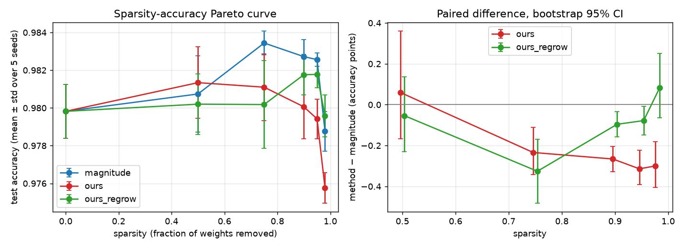

# AQUA: a network that prunes itself while it trains

Pure Python + NumPy. A reverse-mode autodiff engine, an MLP, Adam, and a pruner that removes
connections during training under a hard budget, with measured evidence for what it costs and
what it buys.

**Library statement.** There is no PyTorch, TensorFlow, JAX, Keras, HuggingFace or any other
autodiff / pruning / neural-network library in this repo. `scikit-learn` is used for one
thing only: downloading and parsing the dataset (`fetch_openml` for MNIST, `load_digits` for the
offline smoke-test set), in [train/data.py](train/data.py). Splits, normalisation, batching,
metrics, training, gradients, optimizers, pruning and statistics are all written here.
NumPy does the array work, Matplotlib draws the plots, pytest runs the tests.

## Install

```
python3 -m venv .venv && source .venv/bin/activate
pip install -r requirements.txt        # or: uv pip install -r requirements.txt
```
Python 3.10+. Developed on 3.11 / NumPy 2.4. MNIST is downloaded once into `data/` (git-ignored).

## Commands

| What | Command | Time |
|------|---------|------|
| Gradient-check suite (Part 1) | `python -m pytest tests/test_gradcheck.py tests/test_broadcasting.py` | 1 s |
| Masked-weight correctness test (Part 1) | `python -m pytest tests/test_masked_weights.py` | 1 s |
| Everything | `python -m pytest` | 3 s |
| Part 2 training + learning curve | `python -m experiments.part2_train` | ~1.5 min |
| Part 3 self-pruning run (90%) | `python -m experiments.part3_prune --sparsity 0.9` | ~45 s |
| Part 4 Pareto sweep (80 runs) | `python -m experiments.part4_sweep` | ~30 min on 6 cores |
| Part 4 cost measurement | `python -m experiments.part4_cost` (after the sweep) | 1 min |

Seeds are fixed. BLAS is pinned to one thread in [experiments/__init__.py](experiments/__init__.py)
because float summation order changes with thread count (I saw the 4th decimal move between a
12-thread and a 1-thread run). Re-running `part3_prune` reproduced the sweep's seed-0 numbers
exactly (magnitude 0.9835, ours 0.9816, ours+regrow 0.9835).

Useful flags for Part 3: `--criterion {magnitude,taylor1,taylor2,random}`, `--regrow 0.3`,
`--schedule {cubic,oneshot}`, `--ema 0.99`, `--dataset digits` for a seconds-long offline run.

## Layout

```
engine/   Tensor, graph + backward, ops, finite-difference gradcheck
nn/       Linear, MaskedLinear, MLP builder, init
train/    Adam / SGD (mask-aware), data, loop
prune/    criteria, cubic/one-shot schedule, masking + regrowth, CSR inference
experiments/  part2_train, part3_prune, part4_sweep, part4_cost, ablations, stats
tests/    91 tests
results/  committed plots and raw CSVs
```

## What the results say

Setup: 784-256-128-10 MLP (234,752 prunable weights), Adam lr 1e-3, batch 128, 20 epochs, MNIST
(55k train / 5k val / 10k test). Pruning ramps on a cubic schedule from epoch 2 to epoch 15,
then fine-tunes at the target sparsity. Sparsity counts the three weight matrices; biases are
never pruned (it is 0.17% of parameters either way, `sparsity_incl_bias` is in `pareto.csv`).
Every target was hit **exactly** (e.g. 23,475 weights left at 90%).

**Part 2.** Dense baseline: 98.06% test accuracy on seed 0 (curve in `results/part2_curve_mnist.png`).
Over seeds 0-4 the dense mean is 97.98% ± 0.14.

**Part 4 Pareto (test accuracy, mean ± std over 5 seeds)**

| sparsity | magnitude | ours (Taylor-2) | ours + regrowth |
|---------:|----------:|----------------:|----------------:|
| 0%  | 97.98 ± 0.14 | | |
| 50% | 98.07 ± 0.20 | 98.13 ± 0.19 | 98.02 ± 0.16 |
| 75% | 98.34 ± 0.06 | 98.11 ± 0.18 | 98.02 ± 0.23 |
| 90% | 98.27 ± 0.09 | 98.01 ± 0.17 | 98.18 ± 0.11 |
| 95% | 98.26 ± 0.04 | 97.94 ± 0.11 | 98.18 ± 0.07 |
| 98% | 97.88 ± 0.11 | 97.58 ± 0.08 | 97.96 ± 0.11 |



**The honest headline: my gradient-aware criterion does not beat magnitude pruning.** Paired over
seeds, it is 0.23-0.31 points worse at 75-98% sparsity and loses on every seed. Regrowth makes
it competitive at 90-98% (difference at 98%: +0.08, CI [-0.06, +0.25], not distinguishable from
zero), but it never clearly wins. All the details are in [results/CLAIM.md](results/CLAIM.md)
and `results/baseline_stats.csv`. The ablations (`results/ablations*.csv`, run on separate seeds
100-102 and judged on validation accuracy) show the same ordering, plus: random pruning is far
worse, one-shot pruning at the end is worse than the cubic ramp (and falls apart at 95%: 90.5%
for the first-order Taylor variant), and a longer gradient average (EMA 0.99 vs 0.9) helps the Taylor criteria.

Side observation: magnitude pruned networks at 75-95% beat the dense network by ~0.3 points.
That is regularisation (the dense net's train loss goes to ~0.007 while val loss stays flat around 0.09-0.12), not magic.

**Cost (seed 0, `results/cost.csv`).** FLOPs and stored parameters drop exactly as sparsity
says (2x at 50%, 10x at 90%, 50x at 98%), and the CSR path gives bit-for-bit the same test
accuracy as the dense path. **Wall-clock does not improve in NumPy.** My CSR forward pass is
gather-based and NumPy's dense matmul is tuned BLAS, so at batch 64 the CSR path is 12x slower
at 90% sparsity and still 1.5x slower at 98%; at batch 1 it is 3x slower at 90% and 1.5x slower at
98%. I did not find a crossover. Multiplying the dense matrix by a zero mask (what
`MaskedLinear.forward` does during training) is *not* counted as a speedup anywhere in this repo:
it does the full dense work. The FLOP and parameter numbers are the real claim here, and they
only turn into latency with a proper sparse kernel (see DESIGN.md).

## Reading order for the code

1. [engine/tensor.py](engine/tensor.py), [engine/ops.py](engine/ops.py): the graph and every backward rule.
2. [tests/test_masked_weights.py](tests/test_masked_weights.py): what "honest masking" means and the bug it avoids.
3. [train/optim.py](train/optim.py): how Adam handles the mask.
4. [prune/masking.py](prune/masking.py): prune + regrow event.
5. [DESIGN.md](DESIGN.md): the derivations.
